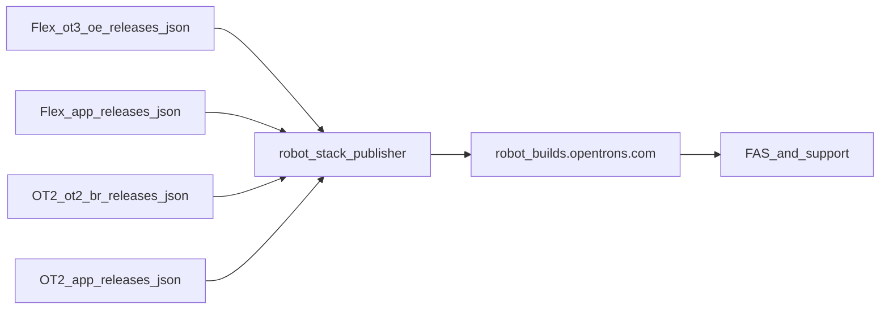

# Official robot builds page

A public, informational Flex and OT-2 download page. It points at the live `releases.json` manifests and the assets they list, so Field Application Scientists can find the stable or beta file a customer should install without opening GitHub.

This page does not replace the sources of truth. Robots keep updating from `releases.json`, and desktop apps keep updating from their channel YAMLs (electron-updater). The page only links to those files, and it does not expose internal hosts, pipelines, or implementation details.

This document is the spec. Build a first version from it, demo that version, then adjust.

## How we will ship it

1. **Build.** Implement the page in this repo from the manifests and filters below, and stand up the hosting in Terraform all the way to `https://robot-builds.opentrons.com`. The demo runs on that real URL with real download links and scheduled publishing on.
2. **Demo.** Walk Nusrat Begum, Alex Copperman, Jess Spangler, and Joe through current stable, current beta, OT-2, the QA-only alpha view, and the full-image disclosure.
3. **Adjust.** Change copy, filters, layout, and the hostname if they want a different one, then point FAS at the page. A hostname change is a DNS and certificate change, not a rebuild.

Josh owns this spec, the demo, and the follow-up changes. Jesse owns the build and the infrastructure. Alex reviews the demo against the workflow on his page. Nusrat, Jess, and Joe say what FAS will actually send to a customer.

Jira stories, when opened, belong on the build/devops project Jesse already runs.

## Why this exists

[Alex's page](https://alexjoel42.github.io/Make-Version-View-Easier/) is the workflow FAS already like: search a version, expand it, download the desktop installer and the robot system zip. It cannot be the official tool.

- It loads `https://api.github.com/repos/Opentrons/opentrons/releases` in the browser. Unauthenticated GitHub API calls are rate-limited, which is why it fails for people who are not on GitHub.
- It drops every tag containing `beta`, hides `v9.1.0`, and pins OT-2 `26.6.0` as a hardcoded row.
- GitHub release assets are a side publication. Robots install from `releases.json`.

Nusrat's call for the first version: stable and beta. Beta is more prominent because the team uses it more now. Alpha is for QA only, so it is not obvious on the main page: it lives on a separate QA alpha page that is not linked from the main page or its navigation. QA finds it by URL. The main page does not have an alpha checkbox.

## Source of truth

External channel only. One row per version, joining app and robot manifests on the version string.

| Product | Manifest | Notes |
|---|---|---|
| Flex robot | [builds.opentrons.com/ot3-oe/releases.json](https://builds.opentrons.com/ot3-oe/releases.json) | Merge `production` and `productionV2`, V2 wins. Use [`robot_manifest_production_entries`](../automation/release.py). Robots on 9.1.1+ read `productionV2`. |
| Flex app | [builds.opentrons.com/app/releases.json](https://builds.opentrons.com/app/releases.json) | Installers are `Opentrons.dmg`, `Opentrons.exe`, `Opentrons.AppImage`. Skip `*.yml` keys and `revoked: true`. |
| OT-2 robot | [ot2.builds.opentrons.com/ot2-br/releases.json](https://ot2.builds.opentrons.com/ot2-br/releases.json) | Live host. `26.6.0` is the current stable: `ot2-system.zip`, `ot2-fullimage.zip`, release notes. |
| OT-2 app | [ot2.builds.opentrons.com/app/releases.json](https://ot2.builds.opentrons.com/app/releases.json) | Same version keys as the robot manifest for current releases (`26.6.0` on both). |

> **Note: the YAMLs are the app's source of truth, not `releases.json`.** The desktop app updates through electron-updater, which reads the channel YAML files (`latest*.yml`, `beta*.yml`, `alpha*.yml`) directly. `releases.json` has nothing to do with those YAMLs, and this page does not read them. `releases.json` is the cleaner place to find the correct package links per release, so this page uses it for links only.

Use the OT-2 host above. [builds.opentrons.com/ot2-br/releases.json](https://builds.opentrons.com/ot2-br/releases.json) stops at `9.0.0`. The stale constant in [`automation/__init__.py`](../automation/__init__.py) points at that copy; [`automation/ot2_urls.py`](../automation/ot2_urls.py) has the live host.

Snapshot while writing this spec (external):

- Flex stable `9.1.2` (`productionV2`). Flex beta `10.2.0-beta.0`.
- OT-2 stable `26.6.0` on both the app and robot manifests.

Each robot entry is `fullImage`, `system`, `version`, `releaseNotes`. The system zip is the manual update file. The full image is a reflash.

## Page behavior

Recommended public URL: `https://robot-builds.opentrons.com`. The artifacts are already world-readable, so a login wall does not add protection. The page's job is to name the right file.

- Flex and OT-2 on one page.
- Two banners: current stable and current beta. Stable is the customer default. Beta is labeled as beta and shown as a prominent banner, because Flex beta `10.2.0-beta.0` is ahead of stable `9.1.2` and the team uses betas more now.
- Under each version: robot system zip, Mac/Windows/Linux app installers, release notes. Full image sits in a disclosure labeled as a full reflash.
- History with search, newest first. Flex sort reuses `sort_semver_versions_desc`. OT-2 sort reuses `ot2_version_sort_key`.
- Main page lists stable and beta only. Flex has about 250 alphas against about 30 stable-plus-beta rows, so the main history stays short.
- QA alpha page lists alpha versions with the same row layout (system zip, installers, notes, full-image disclosure). It is a separate static file, not linked from the main page, and it is noindex so search engines do not surface it. It is public like everything else on the page; the separation is about discoverability for customers and FAS, not access control.
- OT-2 includes only versions that match the external calendar scheme in [`automation/ot2_calendar_semver.py`](../automation/ot2_calendar_semver.py) (`YY.M.N` plus optional `-alpha.N` / `-beta.N`). That drops `.dev` builds, legacy `8.8.2`, and internal-style keys such as `26.5.19` that currently sit on the external OT-2 manifest.
- Footer shows when the page data was generated, plus links to the four manifest URLs.

Internal hosts (`ot3-development`, `ot2-development`) stay off this page. Engineering inventories already live at [opentrons.github.io/robot-stack](https://opentrons.github.io/robot-stack/).

## Architecture

Publish a static page from this repo. A browser `fetch()` of the manifests would need new CORS headers; those responses have none today. The filter rules already exist in Python and should stay tested there.

- New renderer beside [`automation/publish_assets_pages.py`](../automation/publish_assets_pages.py), reusing [`automation/release.py`](../automation/release.py), [`automation/asset_inventory.py`](../automation/asset_inventory.py), and [`automation/ot2_calendar_semver.py`](../automation/ot2_calendar_semver.py).
- Tests with fixture manifests: V2 wins over legacy, beta sorts ahead of an older stable, alpha absent from the main page and present only on the QA alpha page, OT-2 `.dev` and `8.8.2` omitted, revoked app versions omitted, yml keys omitted, system zip present, full image kept out of the primary actions, main page has no link to the QA alpha page.

### Infrastructure

Everything is in Terraform except what has to stay in the AWS root account (the `opentrons.com` hosted zone and registrar). Jesse decides where the Terraform lives and which account hosts it:

- [`robot-stack-infra`](../robot-stack-infra/) already defines the builds manifests and their distributions, so it is the default home.
- A new account or module is fine if Jesse thinks this page should be isolated from the release buckets.

Terraform covers the S3 bucket, the CloudFront distribution, the ACM certificate (us-east-1), the response headers policy, and a GitHub OIDC role scoped to uploading this page from the `Opentrons/robot-stack` publish workflow. The `robot-builds` DNS record and certificate validation records are the only root-account changes. Changing the hostname later means a new record and certificate, not a new distribution.

### Publishing

No CloudFront invalidation. The HTML is served with a short `Cache-Control` (for example `max-age=300`), so a new upload is visible within minutes. Download links point at the existing build hosts, which already handle their own invalidation during the release.

One GitHub Actions workflow in this repo publishes the page, with two triggers:

- **Schedule.** Three runs on weekdays during Eastern business hours. GitHub cron is UTC, so `0 14,17,21 * * 1-5` lands at 9 AM, noon, and 4 PM EST (10 AM, 1 PM, and 5 PM during daylight time). `robot-stack` is public, so scheduled runs cost nothing. Tune the times after the demo.
- **`workflow_dispatch`.** The last step of a release, after the release `invalidate-cloudfront`, dispatches this workflow so the page shows the new version right away. Add that step to the release sequence in [`README.md`](../README.md) and `.cursor/rules/robot-stack.mdc` once the workflow exists. Whether `just invalidate-cloudfront --execute --wait` dispatches it automatically is a follow-up decision.

Skip unchanged builds. Each run fetches the four manifests and hashes their bodies (or compares `ETag`). The publish step also uploads a small state file (for example `manifest-state.json`) with those hashes. When every hash matches the published state, the run exits without rendering or uploading. A manual `workflow_dispatch` can pass a `force` input to publish anyway, for when the template changes.

The page footer shows when it was generated and the manifest snapshot it reflects.

## Out of scope for the first build

- electron-updater. This page has nothing to do with it: it does not read, write, replace, or depend on the channel YAMLs, and no app update behavior changes because of it.
- The on-robot update client. This page does not change how robots update. It is informational only.
- Internal hosts, internal builds, or engineering internals on the page.
- Alpha on the main page or in its default view.
- Putting this UI on the engineering GitHub Pages site. Not now.
- Auth gating. Never. Everything linked here is public and will stay public.

## Demo questions

These do not block the first build. Answer them in the demo, then adjust.

- Keep `robot-builds.opentrons.com`, or rename it? A rename is a DNS and certificate change only.
- May FAS forward the URL to a customer, or is it an internal lookup that should stay out of customer email?
- OT-2 on the same page in the first version. Recommendation: yes. Alex's page already promised it and then hardcoded one release.
- Is three weekday publishes plus a release-time dispatch fresh enough?
- Full reflash link inside a disclosure, versus system zip only.
- Should the QA alpha page have a name or URL QA will remember (for example `/qa/alpha`), and should it be noindex only, or also hidden from the sitemap?
- Is OT-2 `26.6.0` the latest stable support expects a customer to install? The external manifest also contains newer-looking keys (`26.5.19`, `*.dev*`) that the page will hide.
